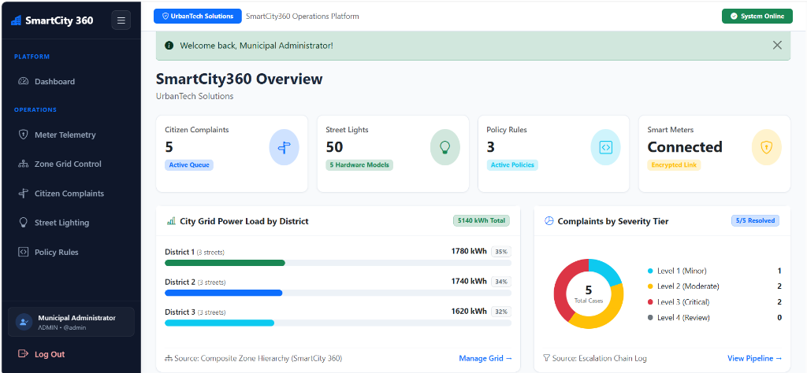
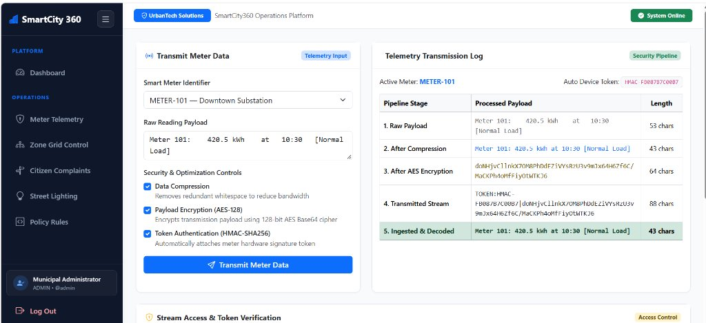
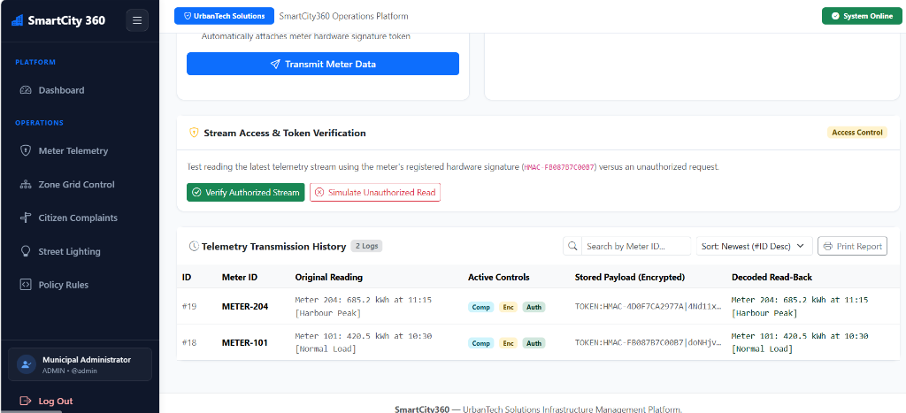
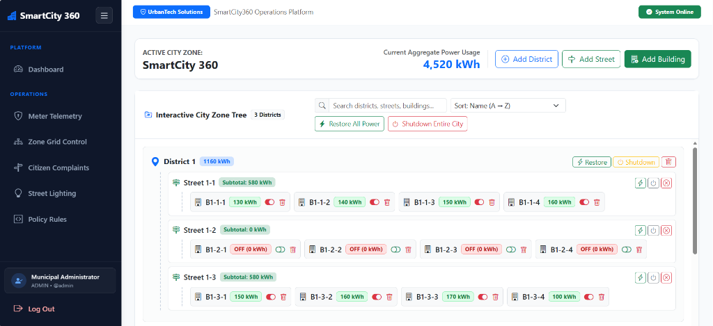
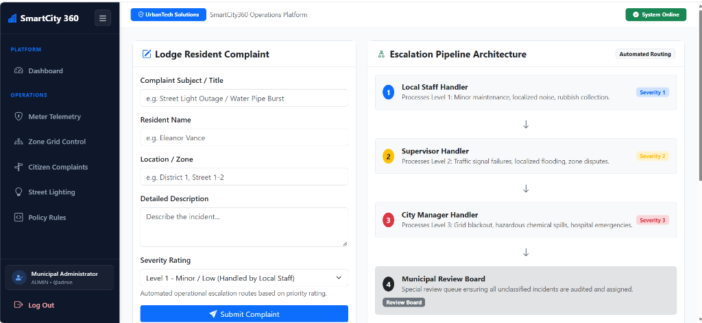
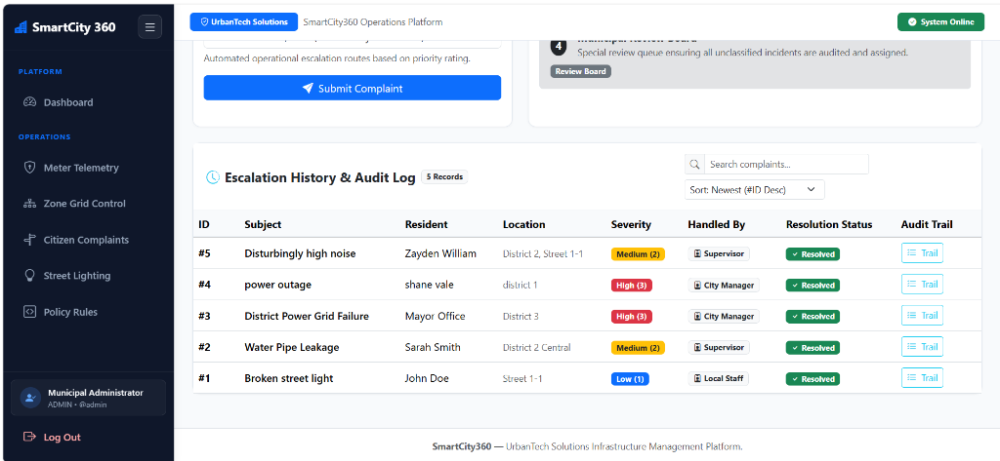
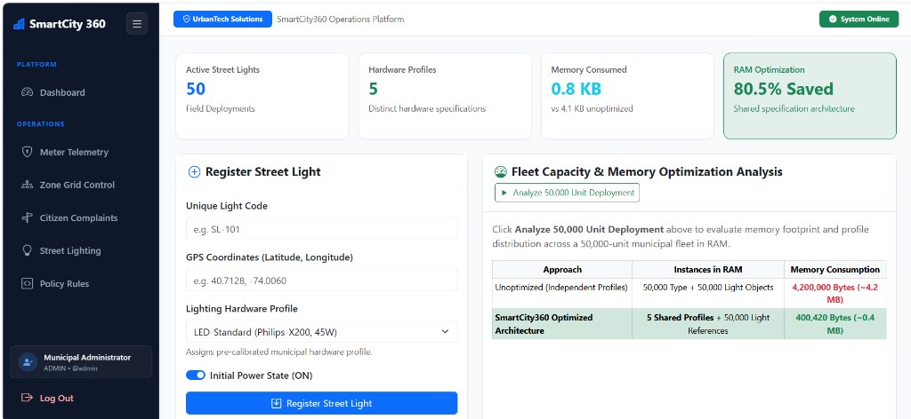
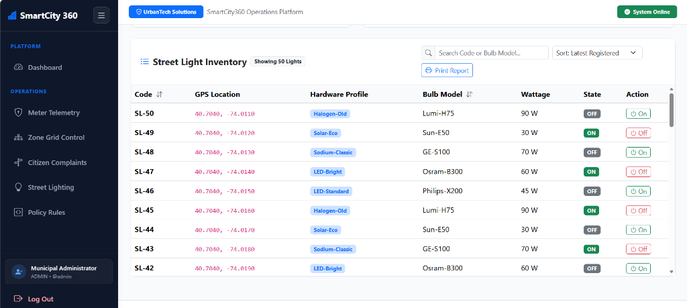
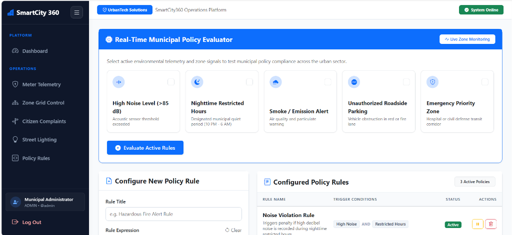
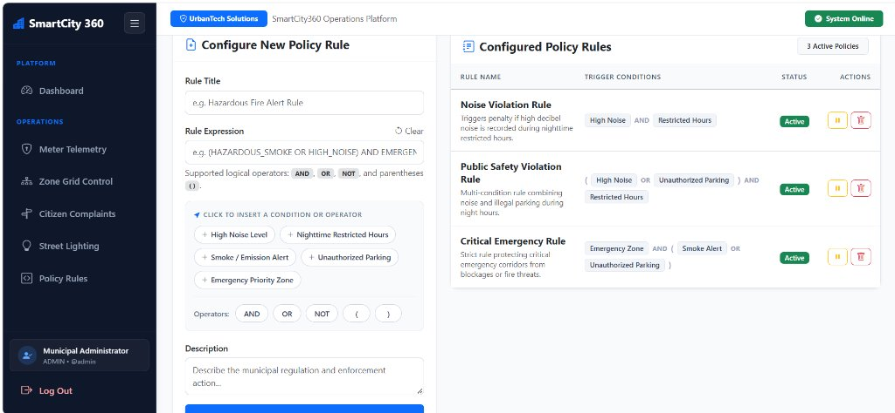

# SmartCity360 — Municipal Infrastructure Management Platform

**UrbanTech Solutions — Enterprise Operations System**


**SmartCity360** is an enterprise Java web application designed for end-to-end municipal infrastructure management and smart city operations. It integrates real-time smart meter telemetry security, hierarchical zone power grid control, automated citizen grievance escalation, memory-optimized street lighting management, and an AST-driven municipal policy rules engine.

---

## Architecture & Design Patterns

Each operational module is engineered around a classic **Gang of Four (GoF)** software design pattern to ensure modularity, scalability, and clean separation of concerns:

| Module | Endpoint | Design Pattern | Architectural Purpose |
|---|---|---|---|
| **Meter Telemetry & Security** | `/decorator` | **Decorator** | Dynamically wraps telemetry streams with whitespace compression, AES-128 encryption, and HMAC-SHA256 device authentication. |
| **Zone Grid Control** | `/composite` | **Composite** | Models the city grid as a recursive tree (`City` &rarr; `District` &rarr; `Street` &rarr; `Building`) supporting uniform power control and load aggregation. |
| **Citizen Complaints** | `/chain` | **Chain of Responsibility** | Routes resident grievances through a multi-tier escalation pipeline (`Local Staff` &rarr; `Supervisor` &rarr; `City Manager` &rarr; `Review Board`) based on severity. |
| **Street Lighting Network** | `/flyweight` | **Flyweight** | Shares intrinsic hardware profiles (`StreetLightType`) across tens of thousands of streetlights, reducing RAM footprint by **>80%**. |
| **Municipal Policy Rules** | `/interpreter` | **Interpreter** | Parses boolean rule expressions (`AND`, `OR`, `NOT`, parentheses) into an Abstract Syntax Tree (AST) for real-time sensor compliance evaluation. |

---

## Platform Screenshots

### 1. Authentication & Operations Dashboard
| Sign-In Console (`/login`) | Executive Overview (`/home`) |
|---|---|
|  |  |

### 2. Smart Meter Telemetry & Security Pipeline (Decorator Pattern)
| Telemetry Input & Security Pipeline | Stream Verification & Transmission History |
|---|---|
|  |  |

### 3. Hierarchical Zone Grid Control (Composite Pattern)


### 4. Citizen Grievance Escalation (Chain of Responsibility Pattern)
| Grievance Intake & Escalation Pipeline | Escalation History & Audit Log |
|---|---|
|  |  |

### 5. Street Lighting Fleet & RAM Optimization (Flyweight Pattern)
| Hardware Profile Sharing & 50,000-Unit Memory Benchmark | Street Light Fleet Inventory |
|---|---|
|  |  |

### 6. Real-Time Municipal Policy Engine (Interpreter Pattern)
| Live Environmental Telemetry Evaluator | Rule Expression Builder & Active Policies |
|---|---|
|  |  |

---

## Tech Stack

- **Language & Runtime:** Java 17 (LTS)
- **Web Tier:** Jakarta Servlet 6.0, JSP, JSTL 3.0
- **Application Server:** Embedded Apache Tomcat 10.1.28 (plus standalone WAR packaging)
- **Persistence & Connection Pooling:** MySQL 8.x with HikariCP 5.1, plus automatic **H2 In-Memory Database** high-availability fallback
- **Frontend UI:** Bootstrap 5.3, Bootstrap Icons, Chart.js
- **Testing:** JUnit 5 (36 automated unit & integration tests) and built-in web diagnostic runner (`/tests`)

---

## Quick Start

### Option A: Run inside IntelliJ IDEA (Recommended)
1. Open the project folder in IntelliJ IDEA (`File -> Open`).
2. Allow Maven to import dependencies from `pom.xml`.
3. Open `src/main/java/com/smartcity360/Application.java`.
4. Right-click and select **Run `'Application.main()'`**.
5. Open your browser at **[http://localhost:8080](http://localhost:8080)**.

### Option B: Run via Terminal / Command Prompt
- **Start the Web Application:**
  ```cmd
  run.bat
  ```
  *(Linux / macOS: `./run.sh` or `mvn compile exec:java`)*
- **Run the Automated Test Suite (36 Tests):**
  ```cmd
  run.bat test
  ```
- **Package Production WAR File:**
  ```cmd
  run.bat war
  ```
  *(Outputs `target/smartcity360.war`)*

---

## Default Login Credentials

On startup, the platform automatically seeds default operator accounts:

| Role | Username | Password |
|---|---|---|
| **Municipal Administrator** | `admin` | `admin123` |
| **City Grid Operator** | `operator` | `operator123` |

---

## Database Configuration

SmartCity360 connects to **MySQL 8.0** by default and automatically initializes the `smartcity360` schema and seed data via `src/main/resources/db/schema.sql`.

> **Zero-Setup Fallback:** If MySQL is not running or unreachable on your machine, `DatabaseManager` automatically falls back to an **embedded H2 in-memory database** in MySQL compatibility mode so the application runs out of the box without any external setup.

To configure your local MySQL connection, update `src/main/resources/db.properties` or set environment variables:

| Property (`db.properties`) | Environment Variable | Default Value |
|---|---|---|
| `db.url` | `DB_URL` | `jdbc:mysql://localhost:3306/smartcity360?createDatabaseIfNotExist=true...` |
| `db.user` | `DB_USER` | `root` |
| `db.password` | `DB_PASSWORD` | `<your_mysql_password>` |

---

## Project Structure

```text
SmartCity360-New/
├── docs/screenshots/                  # UI screenshots for documentation
├── src/
│   ├── main/
│   │   ├── java/com/smartcity360/
│   │   │   ├── Application.java       # Embedded Tomcat 10 launcher
│   │   │   ├── chain/                 # Chain of Responsibility (Citizen Complaints)
│   │   │   ├── composite/             # Composite Pattern (Zone Grid Control)
│   │   │   ├── decorator/             # Decorator Pattern (Meter Telemetry Security)
│   │   │   ├── flyweight/             # Flyweight Pattern (Street Lighting Network)
│   │   │   ├── interpreter/           # Interpreter Pattern (Municipal Policy Engine)
│   │   │   ├── dao/                   # JDBC Data Access Objects
│   │   │   ├── persistence/           # HikariCP + MySQL/H2 failover manager
│   │   │   ├── tests/                 # Built-in system diagnostic suite
│   │   │   └── web/                   # Jakarta Servlets, AuthFilter & Listeners
│   │   ├── resources/
│   │   │   ├── db.properties          # Database connection settings
│   │   │   └── db/schema.sql          # Auto-executed DDL & seed script
│   │   └── webapp/
│   │       ├── assets/css/app.css     # Custom enterprise stylesheet
│   │       └── WEB-INF/views/         # JSP views & layout fragments
│   └── test/java/com/smartcity360/
│       └── SmartCity360TestSuite.java # 36 JUnit 5 unit & system tests
├── pom.xml                            # Maven build configuration
├── run.bat                            # Windows quick-runner script
└── run.sh                             # Linux/macOS quick-runner script
```
